## Sobre mim

Sou **desenvolvedor full-stack** com foco em **IA e automações** (automation developer) e estudante de Ciência da Computação no Centro Universitário Univértix. Crio sites e sistemas web do front-end ao back-end, e transformo tarefas manuais e repetitivas em fluxos automáticos e confiáveis: conecto sistemas, integro APIs e aplico inteligência artificial para que pessoas e empresas dediquem o tempo ao que realmente importa.

## Tecnologias

## Atividade no GitHub

## Caça aos commits

## Projetos em destaque

## Contato

Aberto a projetos de automação, integrações e desenvolvimento. O melhor canal é o [LinkedIn](https://www.linkedin.com/in/cauan-augusto-99b466356).
