### ⚔️ Bem-vindo ao castelo, viajante.

Sou o **Cauan**, desenvolvedor **Front-End** explorando o castelo um salão de cada vez.  
Cada linguagem que domino é uma relíquia; cada projeto, uma área nova do mapa.

---

## 🗺️ Mapa do castelo

  

## 🎒 Inventário: relíquias equipadas

**Equipamento secundário**

## 📜 Status do personagem

## 👾 Fantasmas no calabouço de commits

<picture>
  <source media="(prefers-color-scheme: dark)" srcset="https://raw.githubusercontent.com/CauanDeveloper/MyDevAdventure/output/pacman-contribution-graph-dark.svg">
  <source media="(prefers-color-scheme: light)" srcset="https://raw.githubusercontent.com/CauanDeveloper/MyDevAdventure/output/pacman-contribution-graph.svg">
  
</picture>

## 🏰 Áreas exploradas

| Área | Missão |
| --- | --- |
| 🪑 **Artista Móveis Rústicos** | Site institucional para a empresa Artista Móveis Rústicos (HTML · CSS) |
| 👁️ [**computacao-visual**](https://github.com/CauanDeveloper/computacao-visual) | Experimentos de visão computacional com JavaScript |
| ⚙️ [**Repositorio-Devops**](https://github.com/CauanDeveloper/Repositorio-Devops) | Estudos e práticas de DevOps |

## 🕯️ Save room

Precisa de um aliado na próxima dungeon? Me chama:

🦇 "What is a developer? A miserable little pile of commits." 🦇

