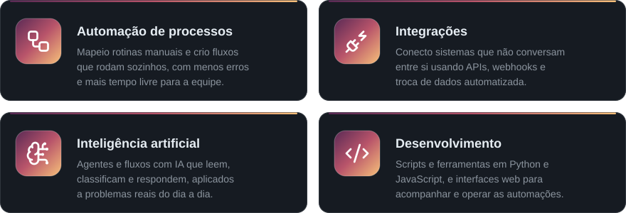
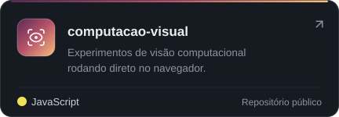

## Sobre mim

Sou **engenheiro de automações** e estudante de Ciência da Computação no Centro Universitário Univértix. Meu trabalho é encontrar tarefas manuais e repetitivas e transformá-las em fluxos automáticos e confiáveis: conecto sistemas, integro APIs e aplico inteligência artificial para que pessoas e empresas dediquem o tempo ao que realmente importa.

## Tecnologias

## Atividade no GitHub

## Projetos em destaque

## Contato

Aberto a projetos de automação, integrações e desenvolvimento. O melhor canal é o [LinkedIn](https://www.linkedin.com/in/cauan-augusto-99b466356).
